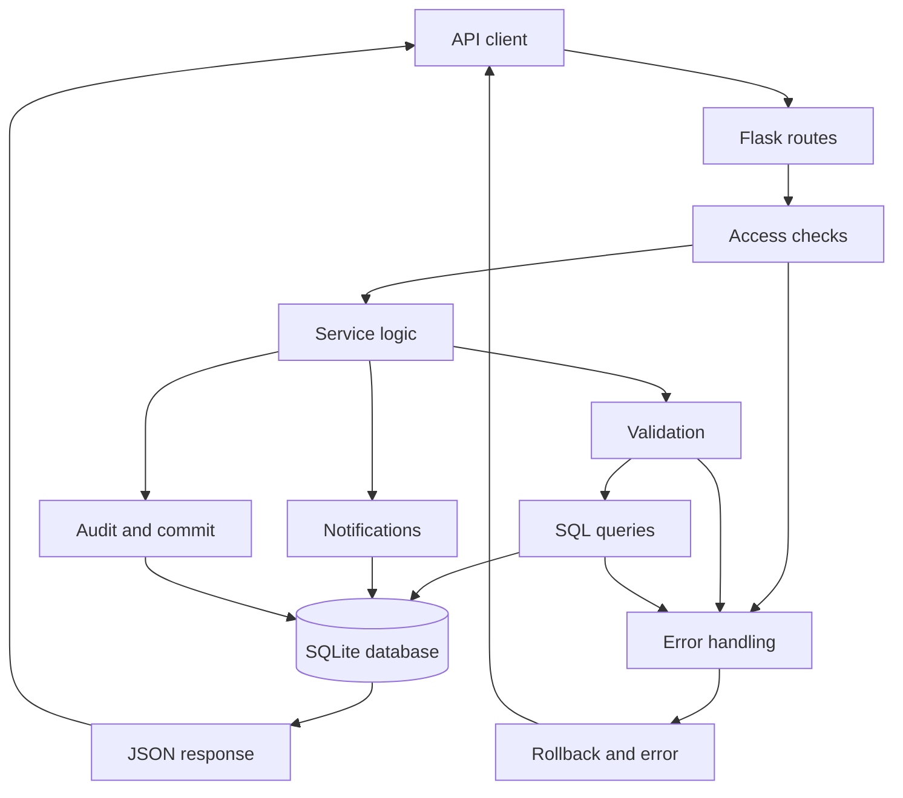

# Security Incident Detection and Response Management Backend

This project provides a REST API for managing organizational assets, reporting cybersecurity incidents, coordinating investigations and response actions, and reviewing security activity. Its goals are to keep related security records consistent, enforce user permissions, track the incident lifecycle, and make each operation testable through Postman.

The backend uses Python, Flask, and SQLite. All nine services are implemented as logical modules in one Flask application with a shared database. Clients access REST endpoints; interactions between service modules currently use Python calls and database relationships within the same process. Separate network-deployed services are not part of this implementation.

## Contributors and services

The route prefixes identify the contributor responsible for each service group.

| Contributor | Services | Main responsibilities |
| --- | --- | --- |
| Ronnie Saba | 1. Users and Identity Management; 2. Asset Management; 3. Incident Management | Accounts, authentication, roles, assets, incident reporting, analyst assignment, investigation notes, and incident status transitions |
| Tracy Ghosn | 4. Threat Intelligence; 5. Security Audit Logging; 6. Security Reports | Threat indicators, activity records, audit queries, and aggregate security reports |
| Farid Abi Doumit | 7. Vulnerability Management; 8. Notification and Alert Management; 9. Security Playbook and Response Automation | Vulnerability remediation, user notifications, ordered response actions, and playbook progress |

## Contents

- [Installation and startup](#installation-and-startup)
- [Configuration and database](#configuration-and-database)
- [Authentication and permissions](#authentication-and-permissions)
- [Request pipeline and service interactions](#request-pipeline-and-service-interactions)
- [API reference and examples](#api-reference-and-examples)
- [Manual API testing with Postman](#manual-api-testing-with-postman)
- [Implementation evidence and references](#implementation-evidence-and-references)

## Installation and startup

Start with Python 3.13 (including `venv` and `pip`), Git, and Postman installed. The commands below are for macOS/Linux and take you from a fresh checkout to a running backend. SQLite is accessed through Python's built-in `sqlite3` module and does not need a separate database server. No existing virtual environment, database, or accounts are assumed.

### 1. Get the project and install dependencies

For a fresh checkout:

```bash
git clone https://github.com/sabaronnie/EECE435L_Sprint1.git Sprint1
cd Sprint1
```

Create a new virtual environment in the project's **parent directory**, keeping it outside the repository:

```bash
python3 -m venv ../.venv
```

Install the project dependencies into the new environment:

```bash
../.venv/bin/python -m pip install -r requirements.txt
```

[requirements.txt](requirements.txt) specifies Flask and Flask-Cors. All following commands use this newly created parent environment directly, so you do not need to activate it.

### 2. Initialize the database

```bash
../.venv/bin/python -m flask --app app init-db
```

The application also initializes missing tables when imported or started. Repeating initialization or restarting the server preserves existing users and records. The default file is `instance/database.db`; its parent directory is created automatically.

### 3. Provision an administrator

Create the first administrator using the trusted local CLI:

```bash
../.venv/bin/python -m flask --app app create-admin \
  --full-name "Farid Abi Doumit" \
  --username Farid_Admin \
  --email Farid_Admin@gmail.com \
  --department Security
```

The command prompts for a password and confirmation without displaying it. Passwords must contain 8–128 characters, including uppercase, lowercase, a digit, and a symbol. An existing username or email causes an error; this command does not overwrite an account or reset the database.

### 4. Run the server

```bash
../.venv/bin/python app.py
```

The application listens on **http://127.0.0.1:5001**. Keep this terminal running and stop it with `Ctrl+C`. Starting Flask does not log in as the administrator; authenticate through `/api/RonnieSaba/users/login` after startup.

The equivalent Flask CLI command must specify the port explicitly:

```bash
../.venv/bin/python -m flask --app app run --port 5001
```

The CLI's default port is independent of `app.run(port=5001)`. If a port is occupied, choose another CLI port and change Postman's `base_url` to match. These commands use Flask's local development server; see the [Flask development-server documentation](https://flask.palletsprojects.com/en/stable/server/) for its intended use.

## Configuration and database

| Setting | Current value/default | How to configure |
| --- | --- | --- |
| `DATABASE_PATH` | `<project>/instance/database.db` | Export an environment variable before initialization and startup |
| `CORS_ORIGINS` | Unset; no CORS origins configured | Export a comma-separated list of allowed browser origins if needed |
| `TOKEN_TTL_SECONDS` | `3 * 24 * 60 * 60` — three days | Edit `app.config` in [app.py](app.py), then restart; applies to newly issued tokens |
| `MAX_CONTENT_LENGTH` | 16 KiB | Edit `app.config` in [app.py](app.py) |
| Development port | `5001` | Use `app.py`, or pass `--port` to `flask run` |

For an alternative database, use the same exported path for every database command and server run:

```bash
export DATABASE_PATH="$PWD/instance/demo.db"
../.venv/bin/python -m flask --app app init-db
../.venv/bin/python -m flask --app app create-admin
../.venv/bin/python app.py
```

Changing the path selects a different database; it does not copy users from the original file. Environment variables are read at startup. The direct `python app.py` command does not load a `.env` file automatically.

The tables are `roles`, `departments`, `users`, `auth_sessions`, `assets`, `incidents`, `investigation_notes`, `threats`, `logs`, `vulnerabilities`, `notifications`, `playbooks`, and `response_actions`. Reports query these tables instead of maintaining a separate reports table.

[database/__init__.py](database/__init__.py) initializes tables in dependency order. [database/connection.py](database/connection.py) opens request-scoped connections and enables `PRAGMA foreign_keys = ON`. Each table module defines its schema and queries. Parameterized values and constraints enforce relationships and reject invalid or conflicting changes.

To inspect a database without changing its contents, use a SQLite viewer or, if the SQLite CLI is installed:

```bash
sqlite3 -readonly instance/database.db '.tables'
sqlite3 -readonly instance/database.db \
  'SELECT user_id, username, account_status FROM users;'
```

Database files and local environments are excluded from Git by [.gitignore](.gitignore). A fresh clone starts without local accounts or records.

## Authentication and permissions

| Code | Role | Scope |
| --- | --- | --- |
| `A` | `SECURITY_ADMINISTRATOR` | Administration and security management operations |
| `N` | `SECURITY_ANALYST` | Investigation and response operations permitted by each route |
| `V` | `AUDITOR` | Review access and report generation; no record modification |
| `R` | `REGULAR_USER` | Own profile, own incident reporting/retrieval, and own notifications |

The API tables below describe the **implemented permissions**, including route-specific exceptions. The decorators in [auth.py](auth.py) and [app.py](app.py) are the source of truth.

Public signup creates a `REGULAR_USER` without a token. Creating an administrator, analyst, or auditor requires an authenticated administrator. Ordinary signup also accepts an optional valid token from any role; a supplied invalid token is rejected. Login is public. Protected requests send:

```http
Authorization: Bearer YOUR_LOGIN_TOKEN
```

Passwords are stored as salted scrypt hashes. Login returns an opaque session token, and only its SHA-256 hash is stored in `auth_sessions`. Tokens expire three days after issuance; using them does not extend expiry. Logout revokes the current session. Role/status changes revoke all of the affected user's sessions, and inactive or suspended users cannot authenticate. Existing tokens retain their original stored expiry after a lifetime configuration change.

The last active administrator cannot be deleted, demoted, suspended, or deactivated. User responses exclude passwords and password/token hashes.

## Request pipeline and service interactions



For a protected request, Flask identifies the route, authenticates the token, and checks the role and any ownership restriction. The service validates input, checks related records and workflow rules, and calls the database functions. Changes, generated notifications, and their activity record are committed together by `record_activity`. Failed changes are rolled back. Authentication/permission failures are rolled back first, then recorded as a separate audit event where applicable. Read-only retrieval routes return data without creating a mutation activity record.

### Example incident workflow

1. Provision an administrator and use that account to create an analyst and an asset owned by an existing user. Record the returned IDs.
2. A regular user reports an incident using their own `reporter_id` and the existing `asset_id`. The database creates an `Open` incident and records its creation time. An administrator may instead report for another user.
3. A High or Critical incident queues alerts for active administrators. The incident, alerts, and creation log are committed together.
4. An administrator assigns the incident to an active analyst. The assignment updates the incident and queues a notification for that analyst.
5. The assigned analyst retrieves the incident, adds notes, and advances it through `Open → Under Investigation → Mitigated → Resolved → Closed`. Each note stores the authenticated author's ID and a server timestamp. Resolution time is set on entering `Resolved`; a closed incident cannot be reopened.
6. An administrator or auditor reviews the records and aggregate reports. Regular reporters can retrieve their own incidents; an analyst loses incident access if it is reassigned to someone else.

### Cross-service data flow

| Producer/action | Data used by another service | Result |
| --- | --- | --- |
| User management | Existing users and departments | Asset owners, incident reporters/analysts, notification recipients, and response-action assignees reference actual accounts |
| User role/status change | Notification service | The affected user receives a system notification; existing sessions are revoked |
| Incident creation/assignment | Asset/user records and notification service | Valid related records, administrator alerts for High/Critical reports, and analyst assignment notifications |
| High/Critical threat creation | Notification service | Active analysts receive threat alerts |
| High/Critical vulnerability creation | Asset ownership and notification service | Active analysts and the affected asset's owner receive vulnerability alerts, without duplicating a recipient |
| Response-action assignment | User records and notification service | Active administrators/analysts can be assigned; a different assigned user receives a notification |
| Successful service mutations | Shared audit logging | Actor, action, timestamp, severity, and related service are stored in `logs` |
| Report requests | Users, assets, incidents, threats, vulnerabilities, and logs | Current aggregate summaries and activity statistics are returned without creating business records |

Assets expose linked incident/vulnerability IDs on specific-asset retrieval. Specific-incident retrieval includes investigation notes. Specific-playbook retrieval includes ordered response actions. These associations are read through database relationships, not duplicated client-supplied names.

Vulnerability remediation follows `Open → Under Investigation → In Progress → Resolved → Closed`. Response actions follow `Pending → In Progress → Completed`, and earlier steps must be complete before a later step advances. These are state-tracking APIs; adding or completing an action does not execute operating-system commands or automatically remediate an asset.

## API reference and examples

Server base URL: `http://127.0.0.1:5001`. Append each full path below, for example `{{base_url}}/api/RonnieSaba/assets/1` in Postman. Path names are case-sensitive. Replace `{...}` placeholders with actual IDs/usernames. Numeric IDs in the sample bodies are illustrative; use IDs returned by your own requests.

For JSON requests, choose **Body → raw → JSON** and send `Content-Type: application/json`. GET and DELETE requests have no required body. No body is required for logout or marking a notification read. Unknown JSON fields are rejected. Search filters are URL query parameters, not a JSON body; supply at least one supported filter. Multiple filters are combined using AND.

Text validation trims surrounding whitespace and rejects blank strings, excessive lengths, and embedded control characters. JSON record IDs must be positive integers, not quoted numeric strings or booleans. Enum values are case-sensitive. Server-generated timestamps use UTC ISO 8601 values. Parameterized SQL handles input values as data; validation does not generally remove HTML-like text from otherwise valid string fields.

Creation endpoints normally return `201`; successful reads, updates, deletions, login, and logout return `200`. Each API table identifies the response data key. Successful responses include `status: "success"`, with a `message` on mutation/login responses. List/search data keys contain arrays, which are empty when no rows match.

### Example identities

The examples distribute account creation, ownership, reporting, investigation, and review across all three contributors. These are sample accounts, separate from the contributor prefixes in the real API routes.

| Full name | Example username/email | Role | Example use |
| --- | --- | --- | --- |
| Farid Abi Doumit | `Farid_Admin` / `Farid_Admin@gmail.com` | `SECURITY_ADMINISTRATOR` | Bootstrap account, asset creation, incident assignment, vulnerability and playbook management |
| Ronnie Saba | `Ronnie_Regular` / `Ronnie_Regular@gmail.com` | `REGULAR_USER` | Public registration, asset ownership, incident reporting, and personal notifications |
| Tracy Ghosn | `Tracy_Analyst` / `Tracy_Analyst@gmail.com` | `SECURITY_ANALYST` | Assigned investigations, notes, response actions, and threat-review examples |
| Ronnie Saba | `Ronnie_Auditor` / `Ronnie_Auditor@gmail.com` | `AUDITOR` | Read-only review of users, assets, incidents, logs, and reports |

Create Farid's administrator through the CLI, Ronnie's regular account through public registration, and Tracy's analyst/Ronnie's auditor accounts with an admin token. Set each account's `full_name` and email to match this table. For readable sample bodies, owner/reporter ID `2` represents Ronnie and analyst ID `3` represents Tracy; log user ID `3` also refers to Tracy. These numbers illustrate creation order in a fresh database; always replace them with your actual returned IDs.

### 1. Users and Identity Management

Source: [users_management.py](services/users_management.py). Account updates and privileged role creation are protected separately from public signup.

| Method | Full path | Access | Request | Success |
| --- | --- | --- | --- | --- |
| `POST` | `/api/RonnieSaba/users/register` | Public regular signup; A privileged | Full name, username, email, password, department, role; see example | `201`, user |
| `POST` | `/api/RonnieSaba/users/login` | Public | `identifier`, `password` | `200`, token, token_type, expires_at, user |
| `POST` | `/api/RonnieSaba/users/logout` | A/N/V/R | No body | `200`, status + message |
| `GET` | `/api/RonnieSaba/users` | A/V | No body | `200`, users |
| `GET` | `/api/RonnieSaba/users/{username}` | A/V/R; R own profile | Username path value | `200`, user |
| `PUT` | `/api/RonnieSaba/users/{user_id}` | A/R; R own profile | All: `full_name`, `email`, `department` | `200`, user |
| `DELETE` | `/api/RonnieSaba/users/{user_id}` | A | User ID | `200`, status + message |
| `PUT` | `/api/RonnieSaba/users/{user_id}/role` | A | `role` | `200`, user |
| `PUT` | `/api/RonnieSaba/users/{user_id}/status` | A | `account_status` | `200`, user |

Public registration example:

```json
{
  "full_name": "Ronnie Saba",
  "username": "Ronnie_Regular",
  "email": "Ronnie_Regular@gmail.com",
  "password": "DemoPass1!",
  "department": "Security",
  "role": "REGULAR_USER"
}
```

For an auditor account, use `Ronnie_Auditor`, `Ronnie_Auditor@gmail.com`, and `AUDITOR` with an admin token. Usernames/emails are normalized to lowercase; uniqueness constraints also compare them case-insensitively. Public signup and privileged account creation reject duplicate usernames or emails with `409`.

Login example, with **No Auth**:

```json
{"identifier": "Farid_Admin", "password": "YOUR_ADMIN_PASSWORD"}
```

Login returns `status`, `message`, `token`, `token_type`, `expires_at`, and `user`. Copy the actual returned token manually. The user object includes `user_id`, `full_name`, `username`, `email`, `department`, `role`, `account_status`, `created_at`, and `last_login_at`.

Profile update example: Farid's administrator updates Tracy Ghosn's account using Tracy's actual user ID in the URL. All three fields are required:

```json
{"full_name": "Tracy Ghosn", "email": "Tracy_Analyst@gmail.com", "department": "Security"}
```

Role change: `{"role":"SECURITY_ANALYST"}`. Account status change: `{"account_status":"Suspended"}`; valid statuses are `Active`, `Inactive`, and `Suspended`. Role/status routes and logout are implemented extensions to the brief's six named user APIs.

### 2. Asset Management

Source: [assets_management.py](services/assets_management.py).

| Method | Full path | Access | Request | Success |
| --- | --- | --- | --- | --- |
| `GET` | `/api/RonnieSaba/assets` | A/V | No body | `200`, assets |
| `POST` | `/api/RonnieSaba/assets` | A | Six required fields plus optional OS/location/status; see example | `201`, asset |
| `GET` | `/api/RonnieSaba/assets/search` | A/N/V | Supported query filters below | `200`, assets |
| `GET` | `/api/RonnieSaba/assets/{asset_id}` | A/N/V | Asset ID | `200`, asset |
| `PUT` | `/api/RonnieSaba/assets/{asset_id}` | A | All five editable fields; see example | `200`, asset |
| `DELETE` | `/api/RonnieSaba/assets/{asset_id}` | A | Asset ID | `200`, status + message |

Create example:

```json
{
  "asset_name": "Ronnie Saba Security Server",
  "asset_type": "Server",
  "ip_address": "192.0.2.10",
  "department": "Security",
  "owner_id": 2,
  "criticality_level": "High",
  "operating_system": "Linux",
  "location": null
}
```

The six fields through `criticality_level` are required. Optional `operating_system` and `location` accept omission or JSON `null`; provided strings must be nonblank and at most 120/200 characters respectively. Optional `status` defaults to `Active`, but explicit `null` is rejected. Statuses are `Active`, `Inactive`, and `Under Maintenance`. Criticality is `Low`, `Medium`, `High`, or `Critical`. Asset types are `Server`, `Workstation`, `Database`, `Application`, `Network Device`, and `Cloud Resource`. IPv4 and IPv6 addresses are validated and normalized.

Update example; all five fields are required:

```json
{"asset_name":"Ronnie Saba Updated Server","owner_id":2,"department":"Security","criticality_level":"Critical","status":"Active"}
```

Asset type, IP address, operating system, and location cannot currently be updated. Asset deletion returns `409` if incidents or vulnerabilities reference it.

Search example: `GET /api/RonnieSaba/assets/search?department=Security&criticality_level=High`. Supported filters: `asset_name`, `asset_type`, `ip_address`, `department`, `criticality_level`. Names/departments use case-insensitive substring matching; other fields use exact matching after validation/normalization. Specific retrieval additionally returns `related_incident_ids` and `related_vulnerability_ids`.

### 3. Incident Management

Source: [incidents_management.py](services/incidents_management.py).

| Method | Full path | Access | Request | Success |
| --- | --- | --- | --- | --- |
| `GET` | `/api/RonnieSaba/incidents` | A/V | No body | `200`, incidents |
| `POST` | `/api/RonnieSaba/incidents` | A/R | Title, description, category, severity, reporter ID, asset ID | `201`, incident |
| `GET` | `/api/RonnieSaba/incidents/{incident_id}` | A/N/V/R; N assigned / R reported | Incident ID | `200`, incident |
| `PUT` | `/api/RonnieSaba/incidents/{incident_id}/assign` | A | `analyst_id` | `200`, incident |
| `PUT` | `/api/RonnieSaba/incidents/{incident_id}/status` | A/N; N assigned | `status` | `200`, incident |
| `POST` | `/api/RonnieSaba/incidents/{incident_id}/notes` | A/N; N assigned | `note_content` | `201`, note |

Create example; all six fields are required:

```json
{
  "title": "Ronnie Saba suspicious connection",
  "description": "Ronnie Saba reported suspicious outbound activity on the affected server.",
  "category": "Malware",
  "severity": "High",
  "reporter_id": 2,
  "asset_id": 1
}
```

Severity is `Low`, `Medium`, `High`, or `Critical`. The server supplies the initial `Open` status and creation timestamp; assignment and resolution date initially remain null. Regular users must use their own reporter ID. Specific retrieval returns joined reporter/asset/analyst information and an `investigation_notes` array.

| Operation | Example JSON body |
| --- | --- |
| Assign an active analyst | `{"analyst_id":3}` |
| Advance an Open incident | `{"status":"Under Investigation"}` |
| Add a note | `{"note_content":"Tracy Ghosn reviewed network logs and isolated the affected host."}` |

An administrator or the assigned analyst may add notes or advance status. Notes use the authenticated author and a server timestamp. Skipped, backward, repeated, and post-closure status changes return `409`.

### 4. Threat Intelligence

Source: [threats_management.py](services/threats_management.py).

| Method | Full path | Access | Request | Success |
| --- | --- | --- | --- | --- |
| `GET` | `/api/TracyGhosn/threats` | A/N/V | No body | `200`, threats |
| `POST` | `/api/TracyGhosn/threats` | A | All fields in example | `201`, threat |
| `GET` | `/api/TracyGhosn/threats/search` | A/N | Supported query filters below | `200`, threats |
| `GET` | `/api/TracyGhosn/threats/{threat_id}` | A/N/V | Threat ID | `200`, threat |
| `PUT` | `/api/TracyGhosn/threats/{threat_id}` | A | Non-empty subset: description, severity, source | `200`, threat |
| `DELETE` | `/api/TracyGhosn/threats/{threat_id}` | A | Threat ID | `200`, status + message |

Create example; all fields are required:

```json
{"threat_type":"IP Address","threat_value":"198.51.100.20","description":"Suspicious source reviewed by Tracy Ghosn during investigation.","severity":"High","source":"Tracy Ghosn investigation"}
```

Supported types: `IP Address`, `Domain`, `File Hash`, `Malware Signature`, `Other Indicators`. IP/domain/hash values receive type-specific validation. The API accepts `severity`, while stored/returned records use `severity_level`. Duplicate type/value pairs return `409`.

Update example: `{"description":"Tracy Ghosn confirmed the indicator during security review.","severity":"Critical","source":"Tracy Ghosn security review"}`. Any non-empty subset of these three fields is accepted; indicator type/value are not editable.

Search example: `GET /api/TracyGhosn/threats/search?severity=High&source=investigation`. Supported filters: `threat_type`, `threat_value`, `severity`, `source`. In the current routes, auditors may list/retrieve threats but cannot use the search endpoint.

### 5. Security Audit Logging

Source: [audit_logging.py](services/audit_logging.py) and [database/logs.py](database/logs.py).

| Method | Full path | Access | Request | Success |
| --- | --- | --- | --- | --- |
| `POST` | `/api/TracyGhosn/logs` | A | All fields in example | `201`, log |
| `GET` | `/api/TracyGhosn/logs` | A/V | No body | `200`, logs |
| `GET` | `/api/TracyGhosn/logs/search` | A/V/N | Supported query filters below | `200`, logs |
| `GET` | `/api/TracyGhosn/logs/user/{user_id}` | A/V | User ID; empty array if no logs | `200`, logs |
| `GET` | `/api/TracyGhosn/logs/{log_id}` | A/V/N | Log ID | `200`, log |
| `DELETE` | `/api/TracyGhosn/logs/{log_id}` | A | Log ID | `200`, status + message |

Manual log creation example; all fields are required:

```json
{"user_id":3,"action":"MANUAL_REVIEW","description":"Tracy Ghosn reviewed the security records.","severity":"Information","related_service":"Security Audit Logging"}
```

The referenced user must exist. The server supplies the timestamp. Requests use `action` and `severity`; responses use `action_performed` and `severity_level`. Severity is `Information`, `Warning`, `Error`, or `Critical`. Logs also arise automatically from business operations and authentication/permission checks.

Search example: `GET /api/TracyGhosn/logs/search?date=2026-10-20&severity=Warning`. Supported filters: `user_id`, `date` (`YYYY-MM-DD`), `action`, `severity`, `related_service`. Log records cannot be edited; the API does provide admin-only deletion, which creates a separate deletion audit record. Analyst access to specific-log/search routes is allowed by the current implementation.

### 6. Security Reports

Source: [reports_management.py](services/reports_management.py) and [database/reports.py](database/reports.py). All six routes require an administrator or auditor and accept no request body or supported filters.

| Method | Full path | Access | Request | Success |
| --- | --- | --- | --- | --- |
| `GET` | `/api/TracyGhosn/reports/summary` | A/V | No body | `200`, report |
| `GET` | `/api/TracyGhosn/reports/incidents` | A/V | No body | `200`, report |
| `GET` | `/api/TracyGhosn/reports/assets` | A/V | No body | `200`, report |
| `GET` | `/api/TracyGhosn/reports/threats` | A/V | No body | `200`, report |
| `GET` | `/api/TracyGhosn/reports/vulnerabilities` | A/V | No body | `200`, report |
| `GET` | `/api/TracyGhosn/reports/activity` | A/V | No body | `200`, report |

Example: `GET {{base_url}}/api/TracyGhosn/reports/incidents`.

Illustrative response shape; counts depend on your database:

```json
{
  "status": "success",
  "report": {
    "total_incidents": 2,
    "incidents_by_severity": {"Low":0,"Medium":0,"High":2,"Critical":0},
    "incidents_by_status": {"Open":2,"Under Investigation":0,"Mitigated":0,"Resolved":0,"Closed":0}
  }
}
```

The summary returns user/asset counts, active incident count, critical threat count, and recent activities. Its `open_incidents` value counts incidents outside both `Resolved` and `Closed`. Other reports group incidents, assets, threats, vulnerabilities, or audit activity. Reports read current records and do not create a separate report entry.

### 7. Vulnerability Management

Source: [vulnerabilities_management.py](services/vulnerabilities_management.py).

| Method | Full path | Access | Request | Success |
| --- | --- | --- | --- | --- |
| `POST` | `/api/FaridAbiDoumit/vulnerabilities` | A | All fields in example | `201`, vulnerability |
| `GET` | `/api/FaridAbiDoumit/vulnerabilities` | A/N/V | No body | `200`, vulnerabilities |
| `GET` | `/api/FaridAbiDoumit/vulnerabilities/search` | A/N/V | Supported query filters below | `200`, vulnerabilities |
| `GET` | `/api/FaridAbiDoumit/vulnerabilities/{vulnerability_id}` | A/N/V | Vulnerability ID | `200`, vulnerability |
| `PUT` | `/api/FaridAbiDoumit/vulnerabilities/{vulnerability_id}` | A/N | Non-empty subset of editable fields below | `200`, vulnerability |
| `DELETE` | `/api/FaridAbiDoumit/vulnerabilities/{vulnerability_id}` | A | Vulnerability ID | `200`, status + message |

Create example; all fields are required. The CVE below is a format example, not a claim about a real vulnerability:

```json
{"title":"Farid Abi Doumit demonstration vulnerability","description":"Farid Abi Doumit documented this finding for remediation review.","cve_identifier":"CVE-2026-12345","cvss_score":7.5,"severity":"High","affected_asset_id":1,"discovery_source":"Farid Abi Doumit assessment"}
```

The affected asset must exist. CVSS must be numeric from 0.0 to 10.0 and is rounded to one decimal place. The implementation requires matching severity: below 4.0 `Low` (including 0.0), 4.0–6.9 `Medium`, 7.0–8.9 `High`, and 9.0–10.0 `Critical`. These are the application's validation rules. Requests use `severity`; responses use `severity_level`.

Update example for an Open vulnerability: `{"description":"Farid Abi Doumit started the remediation investigation.","status":"Under Investigation"}`. Updates accept a non-empty subset of `description`, `severity`, `status`, `cvss_score`, and `resolution_date`. Status must advance one stage when changed; closed records cannot be updated. Resolution time is set automatically on entering `Resolved`, or a valid resolution date may be supplied for resolved/closed records.

Search example: `GET /api/FaridAbiDoumit/vulnerabilities/search?severity=High&status=Open`. Supported filters: `cve_identifier`, `severity`, `affected_asset_id`, `asset_name`, `status`.

### 8. Notification and Alert Management

Source: [notifications_management.py](services/notifications_management.py).

| Method | Full path | Access | Request | Success |
| --- | --- | --- | --- | --- |
| `POST` | `/api/FaridAbiDoumit/notifications` | A | All fields in example | `201`, notification |
| `GET` | `/api/FaridAbiDoumit/notifications/user/{user_id}` | A/N/V/R; N/R own recipient | Recipient user ID | `200`, notifications |
| `GET` | `/api/FaridAbiDoumit/notifications/search` | A/N/V; N own recipient | Supported query filters below | `200`, notifications |
| `GET` | `/api/FaridAbiDoumit/notifications/{notification_id}` | A/N/V/R; N/R own recipient | Notification ID | `200`, notification |
| `PUT` | `/api/FaridAbiDoumit/notifications/{notification_id}/read` | A/N/R; N/R own recipient | Notification ID; no body | `200`, notification |
| `DELETE` | `/api/FaridAbiDoumit/notifications/{notification_id}` | A | Notification ID | `200`, status + message |

Create example; all fields are required:

```json
{"user_id":2,"title":"Farid Abi Doumit security review","message":"Ronnie Saba, please review the security records for your server.","notification_type":"System Notification","severity":"Medium"}
```

Supported types: `Incident Assignment`, `Security Alert`, `System Notification`, `Threat Alert`, `Vulnerability Alert`. Severity uses the four Low-to-Critical values. Notifications start `Unread` with a server creation timestamp. Marking read sets `status` to `Read` and records `read_date`; repeating that operation preserves the existing read timestamp.

Search example: `GET /api/FaridAbiDoumit/notifications/search?status=Unread`. Supported filters: `user_id`, `notification_type`, `severity`, `status`. Analysts are restricted to their own notifications, including searches. Regular users can retrieve their own notifications and mark them read but cannot use the search endpoint. Auditors can retrieve/search notifications but cannot mark them read.

### 9. Security Playbook and Response Automation

Source: [playbooks_management.py](services/playbooks_management.py).

| Method | Full path | Access | Request | Success |
| --- | --- | --- | --- | --- |
| `POST` | `/api/FaridAbiDoumit/playbooks` | A | All fields in example | `201`, playbook |
| `GET` | `/api/FaridAbiDoumit/playbooks` | A/N/V | No body | `200`, playbooks |
| `GET` | `/api/FaridAbiDoumit/playbooks/{playbook_id}` | A/N/V | Playbook ID | `200`, playbook |
| `POST` | `/api/FaridAbiDoumit/playbooks/{playbook_id}/actions` | A/N | Action description, step number; optional assignee | `201`, action |
| `PUT` | `/api/FaridAbiDoumit/actions/{action_id}/status` | A/N | Non-empty subset: status, assigned user, completion date | `200`, action |
| `DELETE` | `/api/FaridAbiDoumit/playbooks/{playbook_id}` | A | Playbook ID | `200`, status + message |

Playbook creation example; all fields are required:

```json
{"playbook_name":"Farid Abi Doumit malware response","description":"Response plan prepared by Farid Abi Doumit to investigate and contain suspicious activity.","incident_category":"Malware","severity":"High"}
```

The server sets `created_by` to the authenticated administrator and generates the creation date. Specific-playbook retrieval includes ordered `response_actions`; listing includes action-count/progress information.

Add an action example:

```json
{"action_description":"Tracy Ghosn reviews the affected server's network connections.","step_number":1,"assigned_user_id":3}
```

`action_description` and a positive integer `step_number` are required. Optional `assigned_user_id` accepts omission/null or an existing active administrator/analyst ID. Step numbers must be unique within a playbook.

Update example: `{"status":"In Progress","assigned_user_id":3}`. A non-empty subset of `status`, `assigned_user_id`, and `completion_date` is accepted. Status progresses from `Pending` to `In Progress` to `Completed`; earlier steps must finish first. When starting unassigned work, the server assigns the acting user. Completion time is generated automatically unless supplied on completion. Completed actions cannot be changed. A playbook with actions currently In Progress cannot be deleted; permitted deletion cascades to its actions.

### Error response format

```json
{"status":"error","message":"Authentication is required"}
```

Some errors include a `details` field with invalid/missing field names, allowed choices, or workflow information.

| HTTP status | Meaning |
| --- | --- |
| `400` | Malformed JSON, invalid input, unknown/missing fields, or invalid related-record selection |
| `401` | Missing/invalid/expired authentication, inactive account, or failed login |
| `403` | Authenticated role lacks permission or ownership/assignment check fails |
| `404` | Resource not found or no matching route |
| `405` | HTTP method not supported for the URL |
| `409` | Uniqueness/foreign-key conflict, protected deletion, or invalid workflow transition |
| `413` | Request body exceeds 16 KiB |
| `415` | JSON endpoint received a missing/unsupported Content-Type |
| `500` | Unexpected server error; details are logged on the server |

## Manual API testing with Postman

### Collection, environment, and login

1. Start Flask yourself using the command above. Create or select one collection named **SPRINT1**, with a folder for each service. If a teammate provides collection/environment JSON exports, import them; no collection export is currently included in this checkout's `postman` directory.
2. Create/select a **SPRINT1** environment. Set `base_url` to `http://127.0.0.1:5001` and create one `token` variable. For manual reuse, optional fields are `login_username`, `login_password`, `register_username`, `register_password`, `register_role`, `user_id`, `analyst_id`, `asset_id`, and `incident_id`. Fill IDs with actual returned values.
3. Add **Setup → Login**: `POST {{base_url}}/api/RonnieSaba/users/login`, Authorization **No Auth**, Body **raw → JSON**:

```json
{"identifier":"{{login_username}}","password":"{{login_password}}"}
```

4. Enter the administrator's actual username/password in the environment. Send Login, expect `200`, and manually copy its returned `token` into the one environment variable named `token`.
5. For a protected request, select Authorization **Bearer Token** and enter `{{token}}`. To test another role, use the same Login request with that account's credentials and replace `token` manually. A collection/folder does not switch accounts automatically.
6. Public registration uses **No Auth** and `REGULAR_USER`. For privileged accounts, temporarily select Bearer Token with an admin token. Use fresh usernames/emails to avoid duplicate-account conflicts.

For a reusable **Setup → Register**, take the registration example and substitute `"{{register_username}}"` for username, `"{{register_username}}@gmail.com"` for email, `"{{register_password}}"` for password, and `"{{register_role}}"` for role. Set `full_name` to the matching person in the example-identity table: Farid Abi Doumit, Ronnie Saba, or Tracy Ghosn. Set `register_role` back to `REGULAR_USER` and Authorization back to No Auth after privileged-account setup.

For JSON IDs, use numbers, for example `"owner_id": 2`. If substituting a numeric environment variable, use `"owner_id": {{user_id}}` without quotes around the variable expression. Use the Params tab for search filters. A JSON selector on the response panel changes display only; it does not configure the request body.

The environment and authorization steps use Postman's [environment variables](https://learning.postman.com/docs/use/send-requests/variables/environment-variables/) and [Bearer token authorization](https://learning.postman.com/docs/use/send-requests/authorization/authorization-types/) features. No scripts, automatic token capture, or automatic ID capture are required for this workflow.

### Suggested execution order

1. Login as `Farid_Admin`; register `Ronnie_Regular`, `Tracy_Analyst`, and `Ronnie_Auditor` with their matching full names and roles.
2. As Farid, create an asset owned by Ronnie using Ronnie's actual user ID. Retrieve it, search it, and update supported fields.
3. Login as `Ronnie_Regular`; report an incident using Ronnie's reporter ID and the asset's ID. Record the returned incident ID.
4. Login as `Farid_Admin`; assign the incident to `Tracy_Analyst` using Tracy's actual user ID. Login as Tracy, retrieve the incident, add a note, and send each permitted status update in order.
5. As Farid, create the threat reviewed by Tracy and the vulnerability documented by Farid. Inspect generated alerts using the intended recipient's token and notification endpoints.
6. As Farid, create a playbook and add ordered actions assigned to Tracy. As Tracy, advance each step sequentially, then retrieve the playbook to see its actions.
7. Login as `Ronnie_Auditor` to inspect audit logs and reports and trace Farid's, Ronnie's, and Tracy's earlier operations.

For each service, retain representative successful requests, validation errors, authentication failures, role/ownership failures, missing-resource cases, and relevant conflicts. Examples include duplicate signup, invalid IP, null/empty optional text handling, wrong analyst role, invalid incident transition, CVSS/severity mismatch, and out-of-order response steps. Use disposable records when testing deletion and confirm linked-record protections separately.

### Save examples and export evidence

After sending a real request, use Postman's **Save Response / Save as example** action to save the actual request/response pair. Capture both request and response for report screenshots, with captions naming the contributor, endpoint, and purpose. Saved examples do not re-execute requests or prove the current server state.

Export the collection and environment as JSON using Postman's [export instructions](https://learning.postman.com/docs/getting-started/importing-and-exporting/exporting-data/). Exported artifacts can be placed under `postman/` for sharing. Remove actual passwords and session tokens before sharing; retain variable names and placeholder values. IDs and response contents should come from the running implementation, not copied illustrative payloads.

### Common setup problems

| Symptom | Check |
| --- | --- |
| Cannot connect | Flask is running; URL, selected environment, and port match |
| Unexpected `403` on port 5000 with no Flask request log | Another listener may own that port; use the configured port 5001 |
| `415` | Request Body is raw JSON and `Content-Type: application/json` is enabled without a conflicting header |
| `400` with a generic browser/proxy message | JSON parsing failed; check commas, quotes, braces, and expanded variables |
| `401` after earlier success | Token expired, was revoked, belongs to an inactive account, or was not copied into the selected environment |
| `403` on a protected route | Check the role and relevant reporter/assignee/notification-owner restriction |
| `404` for an ID | Use the actual returned numeric ID, correct contributor prefix, and route path |
| Users seem missing | Check that initialization and startup use the same `DATABASE_PATH` |

## Implementation evidence and references

Project-specific claims can be traced to these checked-in sources:

| Evidence | Source |
| --- | --- |
| Route paths, HTTP methods, role decorators, JSON response keys, CLI commands, and configuration | [app.py](app.py) |
| Session validation and ownership/assignment restrictions | [auth.py](auth.py) |
| Required/allowed fields, string/ID/enum checks, and normalization | [validation.py](validation.py) |
| Account creation, password hashing, login, session revocation, and last-admin checks | [users service](services/users_management.py) |
| Incident transitions, assignment, notes, and generated alerts | [incident service](services/incidents_management.py) |
| Notification generation and recipient scoping | [notification service](services/notifications_management.py) |
| Vulnerability lifecycle and CVSS/severity rules | [vulnerability service](services/vulnerabilities_management.py) |
| Response-action ordering and lifecycle rules | [playbook service](services/playbooks_management.py) |
| Schemas, foreign keys, and joins | [database modules](database/) |
| Mutation logging/commit and report aggregates | [logs](database/logs.py), [reports](database/reports.py) |

For execution evidence, save actual Postman responses/screenshots, inspect the corresponding database records, and record the revision used with `git log -1 --oneline`. Review contributor history with `git log --oneline --all`. The example bodies and response shapes in this README are documentation examples, not claimed execution results or proof of passing tests.

Official references supporting the tools and mechanisms used here:

- [Flask CLI](https://flask.palletsprojects.com/en/stable/cli/) — application loading, custom commands, and server startup.
- [Werkzeug password helpers](https://werkzeug.palletsprojects.com/en/stable/utils/#werkzeug.security.generate_password_hash) — password hashing and verification.
- [SQLite foreign keys](https://www.sqlite.org/foreignkeys.html) — relationship enforcement and connection-level activation.
- [Postman environment variables](https://learning.postman.com/docs/use/send-requests/variables/environment-variables/) — manually managed reusable request values.
- [Postman authorization](https://learning.postman.com/docs/use/send-requests/authorization/authorization-types/) — No Auth and Bearer Token configuration.
- [Postman export](https://learning.postman.com/docs/getting-started/importing-and-exporting/exporting-data/) — collection/environment JSON exports.
